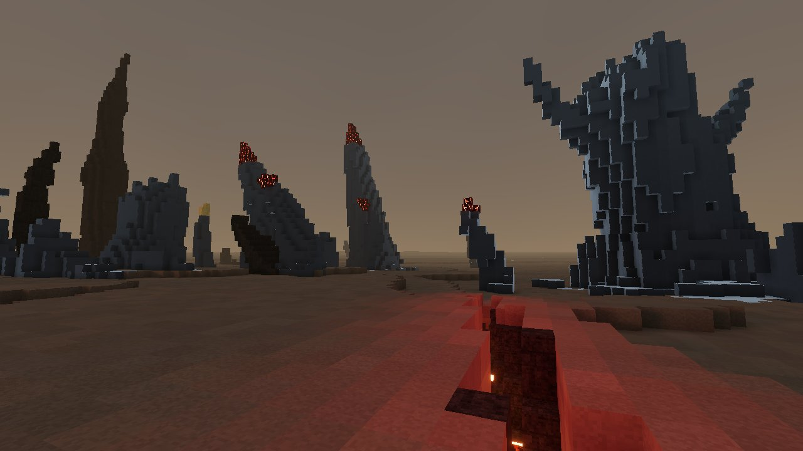
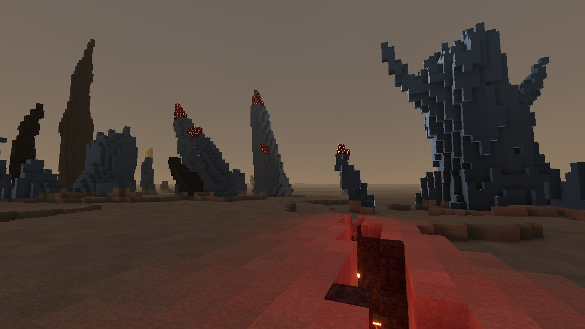
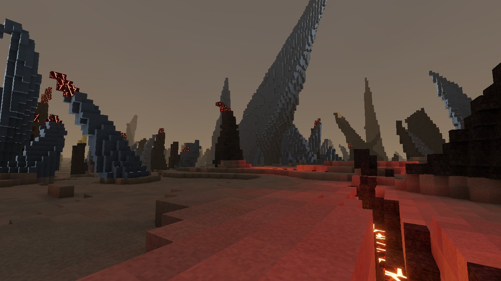

# Ibara visual checkpoint · 12 October 2026

Milestone 1, phase 1.3 is still in progress. The live game remains generation 3 at [dex.place/coldfront](https://dex.place/coldfront/). Code checkpoint `5df496c` passes 732 tests, check/build, clean Node 22 install/build and actual local production browser smoke/drive. The later atlas-CLI checkpoint `a651072` also passes [CI](https://github.com/dexnotavailable/coldfront/actions/runs/38195781782). The generation-4 site build has now passed a native local mounted tour of all sixteen surface regions, map and Test re-entry: nineteen cases, zero application errors, all images independently reviewed.

This is a diagnostic view through the actual game engine, using an isolated source harness. It completed in 149.709 seconds with all 1,135 requested chunks ready, at the unchanged 512 m radius. It is not an accepted postcard. The [receipt](../postcards/m1/HELL-1-diagnostic-033-s1.receipt.json) records its source, camera and image identity. A second view timed out after 180 seconds and produced no image.

A fresh independent Astra reviewer opened the original image and provisionally scored it **13/20, with R2 = 1**. The phase requires at least 16/20 for seed 1 and R2 = 2. Primitive calibration is still incomplete, so this is not a score of record.

The image shows varied sizes, bends and branches, clear volcanic identity and open routes. The remaining visual problems are abrupt root-to-ground transitions, sparse debris around the bases, weak material bands and chunky branch ends. A different view could reveal more landscape scale, but it cannot repair those visible base transitions. Eye-level cameras must retain their valid ground support and +1.62 m eye height.

The next work is deliberately focused:

- Correct the root ash coating, which currently lies largely below ground, and inspect a matched image comparison.
- Investigate the visible thorn and branch silhouettes against the authored shape rules without changing population frequencies from one screenshot.
- Preserve valid completed chunks during postcard travel, then repeat the failed loading journey with the original limits.

The first two corrections now have bounded evidence. The root-material change below uses actual ground height for ash deposits. Independent source and image review accepts the improvement: 18,600 pixels change within the root band, while the upper thorns, tips and foreground fissure remain pixel-exact. Shallow block ledges remain. It adds no full HELL grade.

The automatic capture path now reuses 689 valid destination chunks. In the repeated two-view journey, its first image exactly matches the baseline; the second finishes in 114.567 seconds with only 617 worker requests and all 1,306 chunks ready. Independent review confirms source bindings, request sets, images and clean GPU disposal. This is capture-loading evidence, not an interactive FPS or RX 9060 XT measurement.

Exact measurements found no branch taper or hooked-spine defect in the two investigated thorn IDs. The large branching formation is intentionally broken; the intact hook is obscured in the original view. The next camera work aims to expose the existing shape while preserving standing-eye and safety rules. Decision 115 keeps added composition proxies as ranking diagnostics so valid ungraded images can be inspected; final content and rubric requirements remain mandatory.

The benchmark's submerged sample failure is separately resolved: all 50 dense production samples now qualify with visible faces of their selected thorn, using 53 bounded attempts. The full three-repetition benchmark now passes 2,400 regional pipelines, 960 LOD1 generations and 150 dense pipelines. Generation, lighting and meshing remain above their phase-1.10 targets; [the measured breakdown](../progress.md#bench-latest) separates those costs from FPS. The atlas and slices have been regenerated and independently reviewed; their underground colours are plans inside solid rock, not completed caves.

The public tunnel was also recovered from a missing launcher using its exact verified backup and existing scheduled task. Public metadata, entry assets and isolation headers match the existing release. This HTTP recovery does not add public-browser gameplay evidence.

## Complete cold diagnostic

This view takes **234.974 seconds** to capture all 1,306 chunks from a fresh world. Its original 180-second test remains failed. Decision 116 permits the separate bounded diagnostic continuation for images and profiling; it does not turn the timing result into a pass. The image and [receipt](../postcards/m1/HELL-1-diagnostic-050-s1.receipt.json) retain that boundary.

A fresh blind Astra review gives **15/20 provisionally, R2 = 1**. The coordinator opened both PNG and JPEG. Scale, distribution, identity, atmosphere and visible routes read well. Complete hook and branch silhouettes remain unclear, roots need more natural debris transitions, and the largest thorn has repetitive pale edges. Primitive calibration remains open, so there is no calibrated score of record or phase acceptance.

The passive trace accounts for every one of the 1,306 requests and results. Generation and lighting-volume preparation occupy 97.43% of summed worker stage time across six overlapping workers. It records 681.222 million raw misses and 21,618 cache evictions. These are loading observations, not hardware FPS. A bounded request-order experiment is the next optimization test; the unsuccessful 128-page cold-loading candidate remains isolated, with the production cache still at 96 pages.