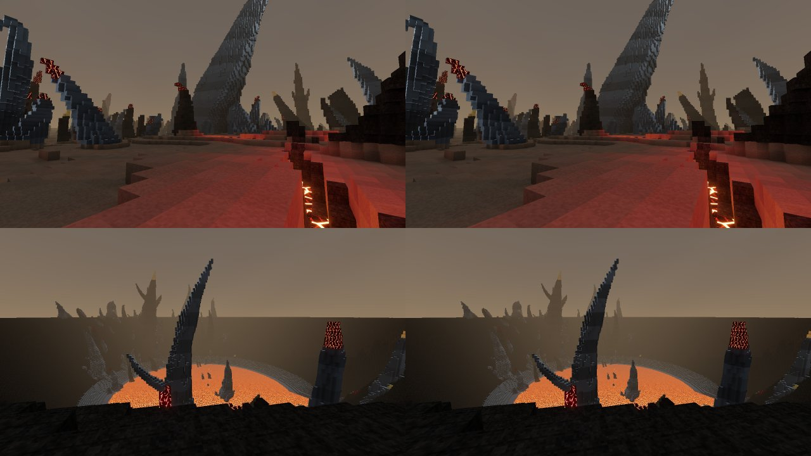

# Ibara rock-layer contrast

The selected material increment makes the existing horizontal rock layers easier to distinguish. Root and a fresh image-only reviewer prefer it in both fixed forest and caldera comparisons, with a modest difference and no obvious lava, ground or form regression. Release qualification is in progress; the live build remains `a82f5dd` until the exact production checks pass.

Forest above caldera; previous material left, selected material right. Root opened all four originals and the assembled 1280×720 JPEG. The sheet is 103,994 bytes; the WIP folder totals 815,775 bytes. The earlier branch-comparison report now links its immutable a82 image.

The shader scales the resolved strata contrast by 1.5 around each feature's existing mean. It retains the pattern, 3–7 m spacing, warp, filtering and fade. Only Normal-view Basalt/Obsidian with a nonzero feature ID use the change. Geometry, ordinary ground, lava, lighting formulas and generation identity remain unchanged. This preserves the mean of the strata factor, not necessarily final image luminance.

## Checks and captures

- **795 tests across 93 files pass**: Vitest 272.59 s, command wrapper 274.045 s. Check/build pass in **20.931/4.514 s**. UI lint reports 106 states, zero missing current rows and 23 bindings; 79 existing warnings remain.
- Forest: **1,306 ready, zero queued**, readiness **146.591 s**, total **149.850 s**; the 180-second check passes. Caldera: **1,624 ready, zero queued**, readiness **228.292 s**, total **232.375 s**; the failed 180-second check and exit 1 remain preserved. Both have zero application errors, four ReadPixels warnings and recorded browser/server closure. Independent audits verify 250/254 file bindings and 69 validation dependencies per view.
- Fresh scoped HUD evidence passes root and independent review: both originals and shipping JPEGs opened, 88 source files and eight artifact bindings verified, 2,440 changed placement-ghost pixels and zero errors. This covers outline, placement ghost and occluded-avatar silhouette; it is not a new full-gallery review.
- The primitive control receives genuine current-generation validation at its original fixed pose: one plan/grid, 127,356 queries, **5.778 s**, with no search or camera adjustment. Its isolated current-material capture loads **1,823 chunks**, zero queued, in **102.039 s**; total **105.626 s**, standard timing pass, zero errors and cleanup recorded true. Its 241 file bindings and 69 dependencies pass independent audit. The generated catalogue adds only this validated primitive section; all eighteen normal destinations and TEST remain unchanged.
- Shared generation stays `676c1de…`; the completed generation-676 golden, numeric-report, atlas/slice and CPU-benchmark evidence remains applicable. CPU generation timing is not a graphics measurement: the current benchmark's **median/p95 is 53.504/577.809 ms**, with the six aggregate kernel-budget misses still open. No Radeon FPS improvement is claimed.

## Formal score boundary

Root scores the current control 8/20, forest 17/20 and caldera 16/20. The first fresh formal reviewer scores the control **9/20**, making its forest/caldera scores invalid under the unchanged calibration rule. A second independent reviewer, shown only the control and rubric, also scores **9/20**. Both failed calibrations are retained; no further reviewers are sought for this candidate and no threshold is changed.

Consequently there is **no new valid formal score of record**. The earlier release's calibrated 16/15 remains historical evidence, not a new score for this material. Preference in the A/B comparisons supports the incremental change; it does not pass phase 1.3. Calibration consistency, mandatory HELL acceptance and seeds 2–3 remain open.

## Evidence

- Main study: `D:/Dex/Temp/coldfront-strata-contrast-a82f5dd/out/strata-contrast/`; caldera `runs/2026-10-13T21-38-43.258Z/`, forest `forest/runs/2026-10-13T21-50-46.864Z/`.
- Separate control: `D:/Dex/Temp/coldfront-strata-primitive-a82f5dd/out/primitive-control/runs/2026-10-13T22-10-09.743Z/` and its `actual-review.md` in `out/primitive-control/`.
- Canonical image preferences: `out/phase13/strata-contrast-pixels/`, `strata-forest-pixels/`; formal grading and both invalid calibrations: `out/phase13/strata-current-grading/`.
- Scoped HUD review: `out/phase13/strata-hud-review/`; fresh release preparation: `out/phase13/strata-release-prep/candidate-f1aa/`. The older parent release packet remains immutable history.
- Full checks and exact eight-file runtime parity: `D:/Dex/Temp/coldfront-strata-integration-1b3958c/out/strata-integration/`.
