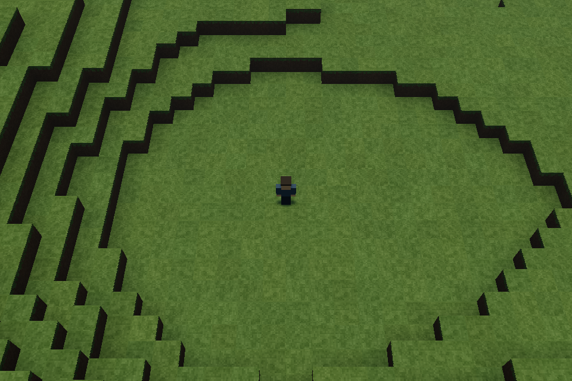
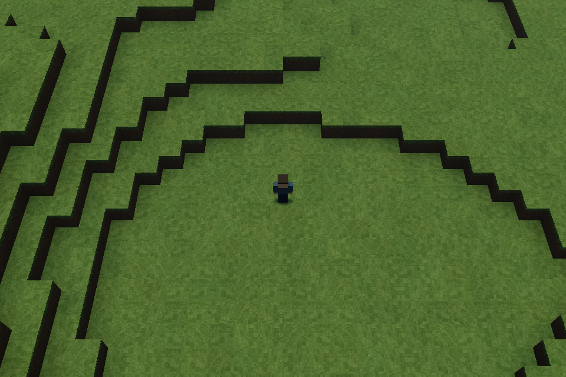
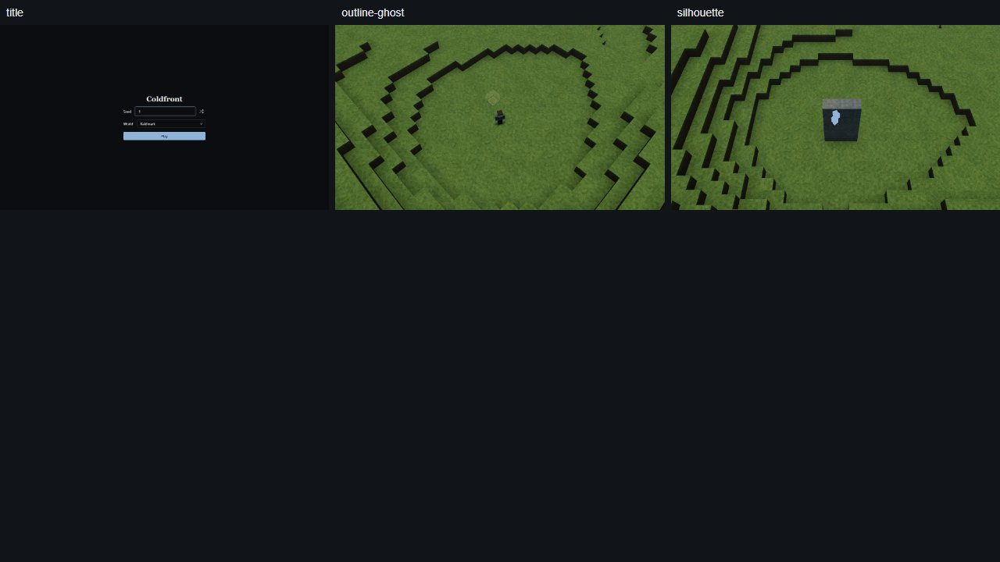
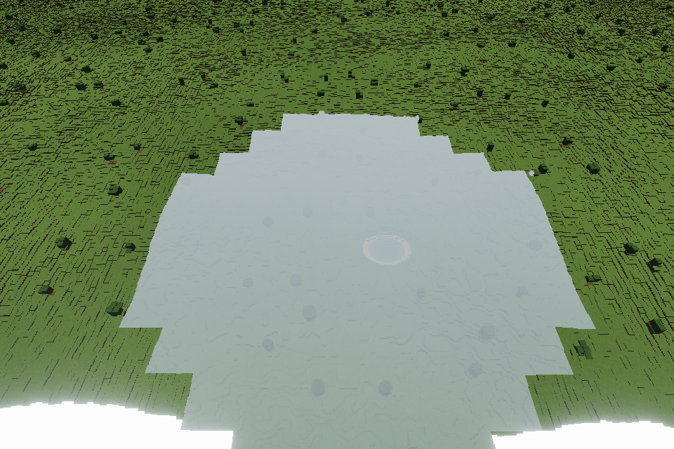

# Phase 1.4 connected-runtime checkpoint

Regional appearance work remains parked by the owner. The connected far-terrain candidate is being verified locally; the public game still serves `ff73f12`. Phase 1.4 is unfinished.

## Implemented scope

The existing six-worker pool now carries far-tile work with cancellation, revision identity and explicit capacity failures. Far-world ownership connects selection, retained parents, edits, batched materials, cut caps, floating origin, GPU preparation, two-pass depth and context recovery to the game. Near uploads account for actual mesh parts while keeping each chunk atomic. The Command controller is independently tested but its input/UI integration remains outstanding.

The first actual TEST startup failed with 502 far nodes selected. The diagnostic reconstructed that exact selection: full deep bounds admitted invisible geometry. Source-certified visibility envelopes now bound the relevant exposed surface, while retaining full run/mesh data and conservative fallback for unknown certificates, deep views, world edges and edits. MAIN bridge intersections do not claim a certificate. Neither the 16 km reach nor the renderer capacity limits were relaxed.

## Executed evidence

| Check | Result and limit |
|---|---|
| Runtime lifecycle repairs | 76 focused tests plus types/lint; stale historical errors and replacement-after-context-recovery regressions reproduced before repair. |
| Visibility correction | 137 focused tests plus shared/client/tools types and lint pass. Tests include the failed TEST pose, cut/edit replanning and conservative fallback. |
| Synthetic GPU smoke | Five material classes and active cut caps render; root opened all three PNGs. Negative-origin rebase changes only 62 pixels by more than three channel levels; hiding caps changes 32,098. Six preparation draws / 794 triangles; not a real-world FPS measurement. |
| Actual TEST startup and movement | Pass, 13.557 s instrumented journey; near chunks 516→568, all ready. Ordinary W input moves 4.101 m. Root opened both PNGs. Far target is correctly zero at this close pose; nonempty far-world rendering is still unproved. |
| Save-copy mechanism | 87 unit tests plus native Chromium IndexedDB copy, source preservation, empty-current precedence, malformed-record refusal, two-connection ordering, late native abort and reload pass. Synthetic exact identities only; no migration activated or live saves touched. |
| Integrated checks | All 1,053 tests / 125 files pass in 285.26 s. A subsequent complete typed mock payload passes its 22 persistence tests. Check and default build pass; 80 warnings and two information notes remain. Fresh HUD capture passes after correcting test tap delivery. Pushed `b29cb2167ed4dbf0a7b7b94394701726ef7715f8` passes exact clean Node 22.23.3 install/build in 22.212 s. Final CI remains pending. |

The game probe explicitly verifies COOP/COEP and cross-origin isolation. All six workers, page, context, browser and local server close. Its 900 ms requested input spans 2,821 ms including observed settling/capture; it does not establish normal hardware frame rate. Native Chromium is pinned to 153.0.8010.12 and uses the authorized local route.

## Images actually opened

- Runtime isolate `out/far-runtime/gpu-smoke/runs/2026-10-15T23-29-00-954Z-d78209f8/`: `01-active-cap-before.png`, `02-active-cap-rebased.png`, `03-same-cut-cap-hidden.png`. Visible material blocks and dark solid cut caps; rebase pair remains stable. Synthetic one-tile scope.
- Runtime isolate `out/far-runtime/game-smoke-v2/runs/2026-10-16T00-19-20-578Z-89038df5/`: `01-default-test-ready.png`, `02-ordinary-movement.png`. Avatar centered on grass ledges; surrounding ledges move with ordinary walking. No blank startup frame. This is not a 5 km scene or new interface-screen acceptance.

No regional rubric score changes. No new words, controls or decorative interface elements are added by this increment. Current-source HUD capture now succeeds, with the four original/candidate images opened before exact promotion.

## Receipts and preserved failures

Canonical integration provenance is `out/phase14/runtime-integration/source-manifest.json`; root logs are under its `checks/` directory. The first integrated persistence-fixture failure and the subsequent renderer-fixture failure are preserved. The repairs change constructor/mock setup only, with 22 and 9 targeted tests passing.

The initial real-game capacity failure, CPU capacity diagnostic and revised game probe remain in `D:/Dex/Temp/coldfront-far-runtime-f918e05/out/far-runtime/`. The failed native-save probe had a duplicate local variable before any database test; its corrected v2 passes in `D:/Dex/Temp/coldfront-save-migration-182e2d5/out/save-migration/browser-proof-v2/runs/2026-10-16T00-22-18-227Z-028e4ea7/`.

The original HUD failure is under `out/phase14/runtime-hud-prep/`. The first timing diagnostic is preserved under `out/phase14/hud-turn-diagnosis/runs/2026-10-16T00-43-52-687Z-ae57de/`: its logger throws `__name is not defined`, records no key events and cannot establish a timing cause. The original captured pose has yaw 25 rather than 45. Do not change the camera or loosen timing/assertions based on that invalid trace.

The corrected diagnostic, `out/phase14/hud-turn-diagnosis-v2/runs/2026-10-16T00-50-48-038Z-41f39e/`, records trusted key events with no browser errors and intact source seals. Their native timestamps span **1,179.55 ms**, and the input-handler observations span **269.985 ms**. The runner waited through a **1,105.12 ms** keydown dispatch delay before starting its requested 70 ms wait. It therefore delivered a hold, not a short tap. The test-runner repair queues native down/up events independently of the down acknowledgement; game input, the 200 ms threshold and all prior assertions remain unchanged. New assertions require actual trusted, non-repeated down/up events less than 200 ms apart.

Fresh capture `out/phase14/runtime-hud-prep-v2/runs/2026-10-17T20-54-06-545Z-e8edd7/` passes: native interval **70.1 ms**, yaw **45°**, zero errors and **2,440** changed ghost pixels. It binds 111 source files. Root opened native `outline-ghost.png` / `silhouette.png` and both candidate JPEGs; thin target outline, faint sand ghost and pale blue occluded silhouette remain visible. Six exact evidence files were promoted with prior/source/destination hash checks.

## Gallery, atlas and slice review

`npm run ui:shots -- --sheet title,outline-ghost,silhouette` passes all nine captures. Root opened `out/ui/{title,outline-ghost,silhouette}-{1280,1920,150}.png` and `_sheet-ui.jpg`. The title reads **Coldfront**, **Seed**, **World**, **Kaldmark**, **Play**, with seed value **1**. The two world fixtures contain no drawn interface words. The first world-only selection failed the runner's injected text-canary check: its normal-flow canary follows a full-height world image and can be offscreen. That failed receipt is preserved; including the ordinary title first executes all unchanged canaries successfully. No assertion was disabled.

| A7 check | Typical title | Outline/ghost and silhouette fixtures |
|---|---|---|
| Exact rows; nothing extra | Pass | Pass for the three existing world HUD rows |
| No clipping/overlap at all three profiles | Pass | Pass; centered image remains intact |
| Alignment and spacing | Pass | Not applicable to world-only stills |
| Listed components/disabled reasons | Pass; no disabled controls | Not applicable; no controls |
| Catalogue layout | Pass | Pass within world-fixture scope |
| Keyboard order and closing | Pass: Seed → Random → World → Play; title has no Esc-close requirement | Not applicable; no focusable controls |

Seed-1 atlas `out/atlas/main/seed-1/surface-regions{,-review}.png` and all four overview/window slice images were regenerated and opened. Regional sectors/rings remain present. The slice retains planned layer tints on solid rock, with no cavern-air claim. Sampling/preparation: atlas **1,901.633/2,082.923 ms**; overview **1,449.885/2,083.896 ms**; 1 m window **7,263.322 ms** with the same preparation.

Fresh bounded TEST benchmark (one warmup/repetition, 50 LOD0 and 20 LOD1 samples): median/p95 milliseconds generation **1.250/1.643**, lighting **13.073/16.299**, meshing **4.074/7.722**, total pipeline **43.925/50.899**, LOD1 generation **1.299/1.460**. Lighting/meshing remain over later targets. Receipt: `out/step4/bench-gen-2026-10-17T20-59-44.532Z.json`. No comparable far-world or Radeon frame-rate result follows.

Current shared fingerprint is `660e072ba87aa2f9da9cfc3e2f335651c57da4253847d93a1e2e60614fa82e45`. The refreshed source-equivalence audit at `out/phase14/save-compatibility-current/` supports the exact live `4:b7facdfdcb615938ecfc1e693c6b7cbe16494ca1a80b2c67ef7e59689b261794` → current `4:660e072ba87aa2f9da9cfc3e2f335651c57da4253847d93a1e2e60614fa82e45` pair. It independently recomputes all hashes: 58 current inputs, 56 matching the prior audit, with only the additive world type/context certificates changed. Manifest SHA-256 `e45ebf18e02c506cf2e79bc0bcaf536a131c79c71d6afc5cadcdf11af95b09eb`; review SHA-256 `32397a5a3096bebba232aa1596b65618d021095e8f06389b2486a9be3fbcbe25`. This replaces neither the preserved older audit nor actual GameRuntime restoration proof. Migration remains inactive.

## Elevated near/far integration: drawing passes, image rejected

The first nonempty actual-game view uses TEST seed 1, camera `(0,240,180)` looking at `(0,6,0)`, 160 m near radius, 70° FOV and the unchanged 16 km far reach. Run `out/phase14/far-game-nonempty/runs/2026-10-17T21-02-55-037Z-af439bbd/` finishes in **17.357 s**. All 388 near chunks are ready; 80 LOD2 far tiles are committed from 122 prepared tiles. Two consecutive native still compositions each submit far (**51 calls / 874,262 triangles**) then near (**279 calls / 220,474 triangles**) to the same color target. Far geometry reserves **176,619,520 bytes**, with **10,957,304 bytes** of retained runs. These are this probe's instrumented counters, not FPS or final budgets. Six workers and all resources close; source seals match and no browser/GL errors are reported.

Root opened `01-test-near-far-ready.png` and **rejected visual acceptance**. The central near patch is pale gray with a sharp edge against the far grass. Dense dark grid/speckle detail covers the far surface, and a white strip shows along the foreground. Source review establishes different near/far fog densities; expansion and near-plane coverage are hypotheses requiring controlled same-pose probes. No regional shape or taste change is selected to hide these integration defects. The successful submission receipt stays separate from `root-image-review.json`'s failed visual assessment.

## Remaining phase work

Resolve the rejected near/far image, then partial-near coverage, forced no-multi-draw fallback, context loss/recovery and gameplay/save journeys. Complete CI for the checkpoint. LOD1 streaming, Command input/catalogue settings, horizon shadows, atmosphere and the five ≥5 km acceptance postcards remain. Publish only a verified increment; no Radeon fix or far-world FPS claim is made.
