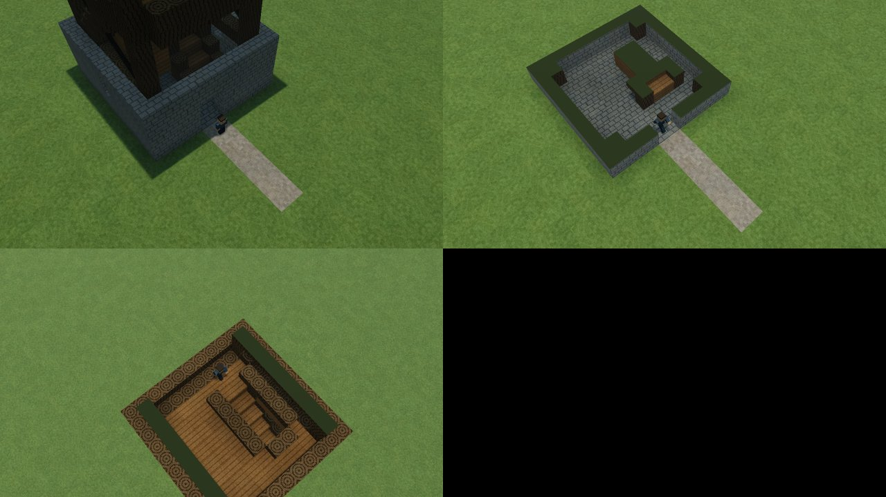

# Watchtower browser ascent

The unchanged watchtower now has a continuous browser controller/camera check. One avatar walks and jumps from the entrance through all 37 route points to the 25-metre lookout. The model and its seven geometry tests are adopted as reusable asset data; no tower is spawned in the live world.

Entry at top left, first cut transition at top right, final platform at bottom left. The fourth tile is intentionally blank. Root opened this 1280 × 720 JPEG sheet; its 124,124 bytes keep all WIP images at 939,899 bytes, below the one-megabyte limit.

## Result

The bounded browser run completes **459 rendered physics ticks and 25 jump inputs**, with all 37 arrivals matching the preserved Node traversal. It ends grounded at local Y **25.000004412 m**. Maximum per-coordinate difference from that historical path is **3.375077994860476e-14 m**, below the unchanged 0.0001 m guard. Execution takes **68.973 seconds**; this is a software-renderer test duration, not FPS or real-time playback speed.

Root and independent Astra open all seven originals: entry, first cut transition, four turning landings and final platform. The avatar and walking level remain visible through the automatic cut at the saved stages. The 24-metre view intentionally crops the upper structure; these are ascent details, not whole-asset framing shots. Seven stills do not establish continuous animation quality or manually steering the route.

Every ordinary input is passed into the current production controller. Historical positions remain outside the browser; there are no position injections, velocity resets or flight. The production overhead camera and renderer update on every tick. All recorded states pass the solid-overlap, flight/swimming, WebGL and isolation guards. Application errors, external requests and source drift are empty. Four ReadPixels warnings remain. Page, context, browser and server close, and root finds no matching remaining process.

Independent review verifies all 481 source bindings, 481 frozen copies, 470 seeded inputs, five historical route/controller bindings, 459 input commands, every arrival predicate and all seven PNG hashes. The existing seven model tests pass in 663 ms; scoped types and formatting pass. The library candidate passes **818 tests / 95 files** in 282.01 s (283.290 s wrapper), check in 23.648 s and build in 3.169 s. Fresh HUD originals and shipping images are opened by root and independent Astra; all 89 sources per case and eight artifact bindings match, with no application errors. The generation/cache tag remains `676c1dee2fe6e97007d306b08f8efeb1381c9d9510f701f4558f22721f2116cb`; only release source identity changes. Exact-commit clean build and CI are the remaining publication/merge checks.

## Preserved failure and correction

The first browser attempt fails at tick 293 after 23 arrivals. The screenshot fixture includes a separate limestone scale cube at local `[7, 15, 9]`; the historical controller fixture does not. The avatar hits that cube's west face, producing a 0.061514 m positional difference. The tower's own sampler returns air at that point.

A one-tick source witness exactly reproduces the failed body with the marker and matches the historical path within 1.78e-14 m without it. The repair selects ascent mode before sampling, lighting and meshing, and excludes only those separate reference cubes. Default static captures retain them. The model, route, controller, camera and all tolerances remain unchanged. The failed run, five originals, trace and independent failed review are preserved; the second run has its own frozen sources and outputs.

## Evidence and scope

Study: `D:/Dex/Temp/coldfront-watchtower-ascent-9ccc495`, based on `9ccc495eeb7fe6342bbbd51668d628b1fa1c8c0e`.

- Failed attempt: `out/watchtower/ascent-pass-01/`; root duration 44.292 s.
- Contact witness: `out/ascent-prep/tick293-marker-witness.json`.
- Accepted attempt: `out/watchtower/ascent-pass-02/` and `ascent-frozen-02/`.
- Independent reviews: `out/ascent-prep/independent-review-01.md` and `independent-review-02.md`, with matching JSON.
- Accepted receipt SHA256: `bb79749d5ddd2a9eceecaf7de4c77b3138be4aedcec88cdd7ce08410b7e923d2`.
- Accepted trace SHA256: `2f3114c082f2dd039ca0f5a92d3d4f37678ea0697bc81cdb23e409ed0b4312e3`.
- Unchanged model SHA256: `ad669481b11b2d507bc474a13de07c5c168afbb09d59ef366257f81cb89ac8a8`.

The original asset checkout remains untouched. Its machine-bound capture harness and calibration cubes are not adopted into the library. Physical keyboard mapping, NPC navigation, construction/support, sight, networking, regional placement and live-world integration remain unproved. This does not complete phase 1.3 or change its terrain scores.
